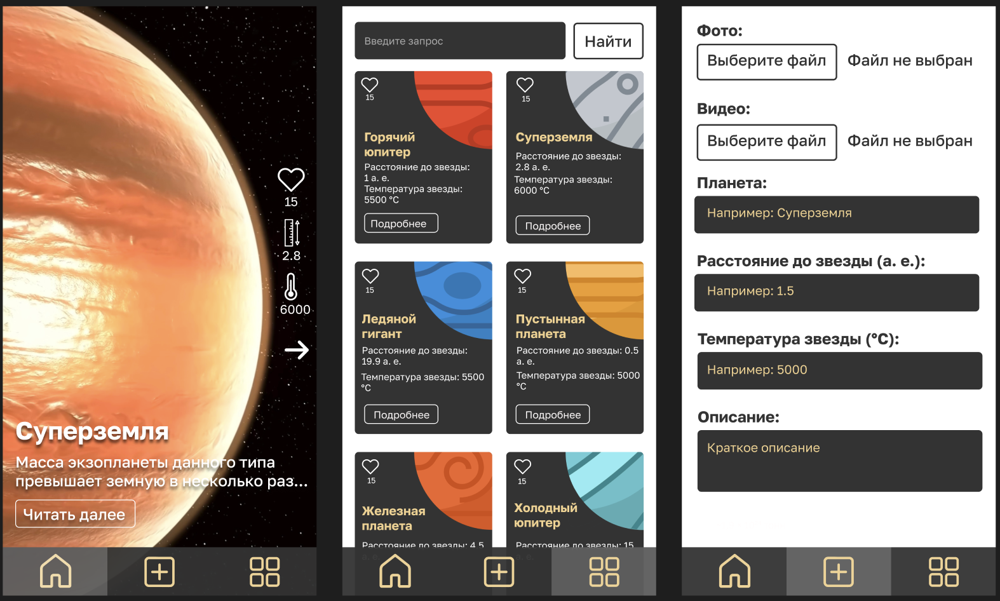
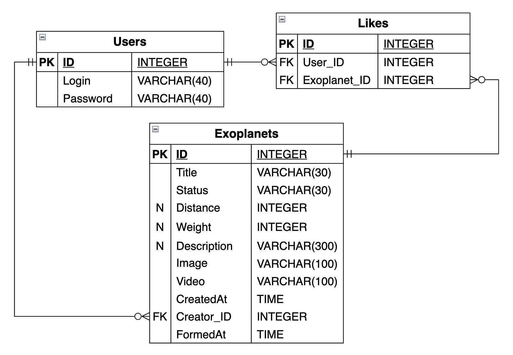
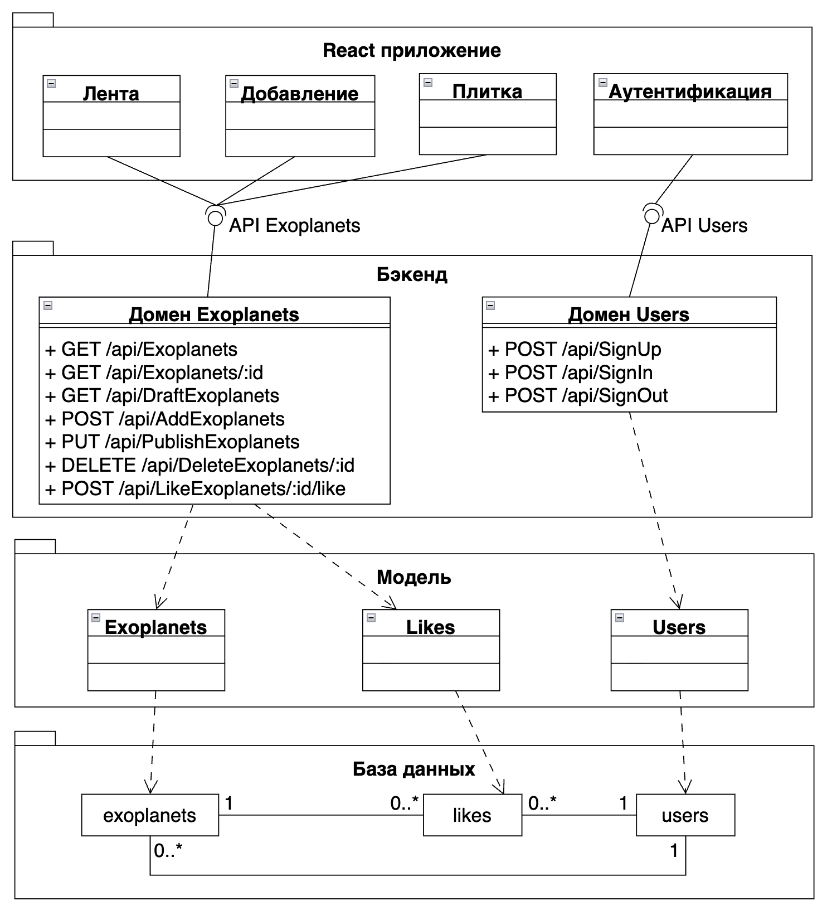
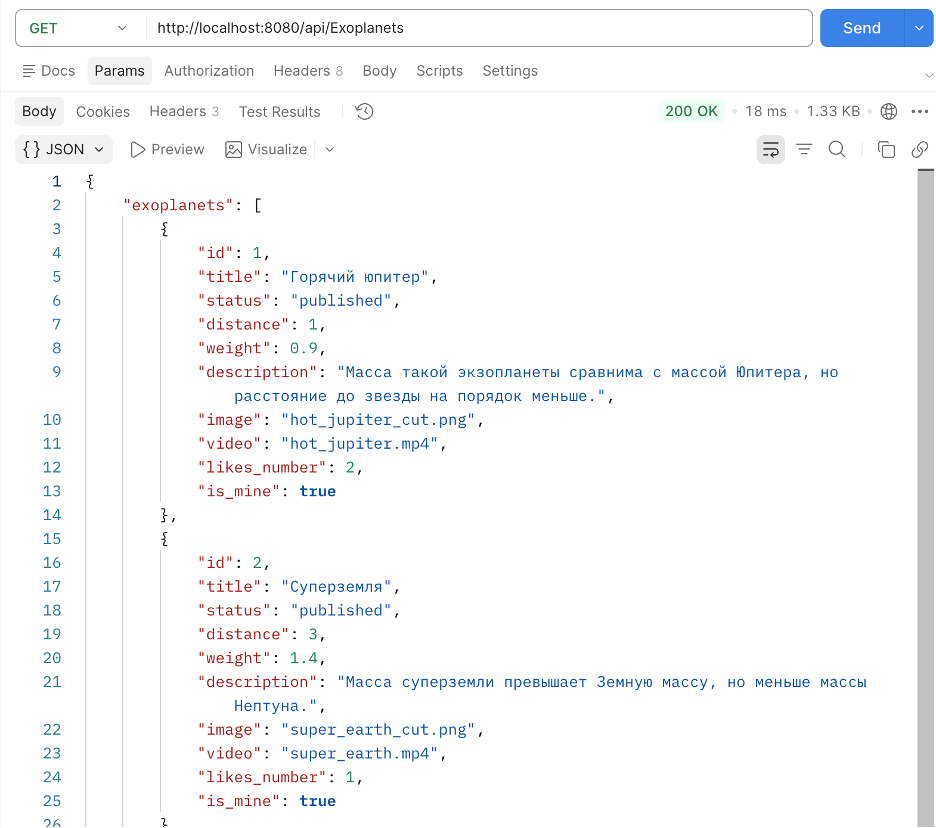
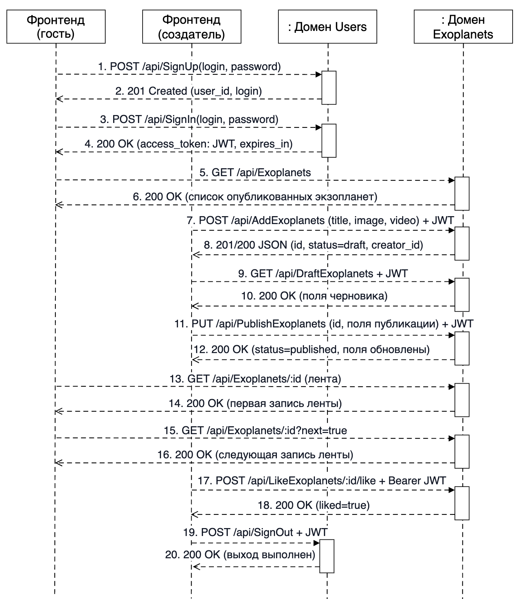
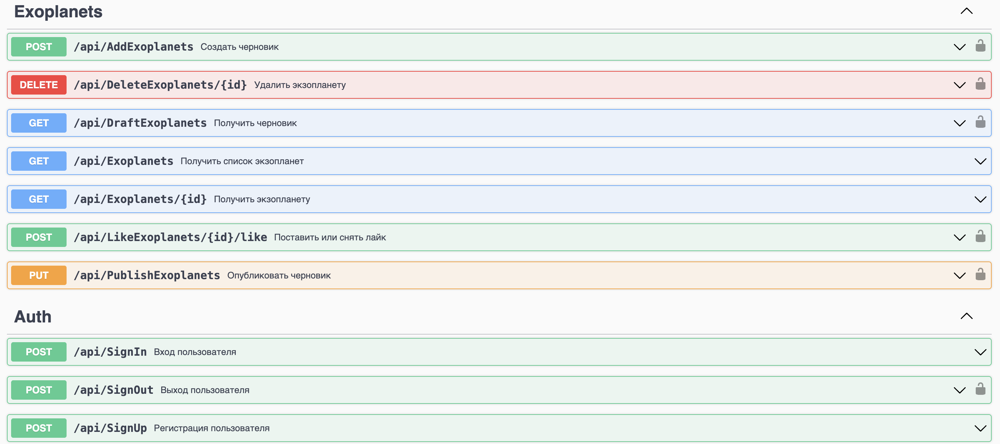
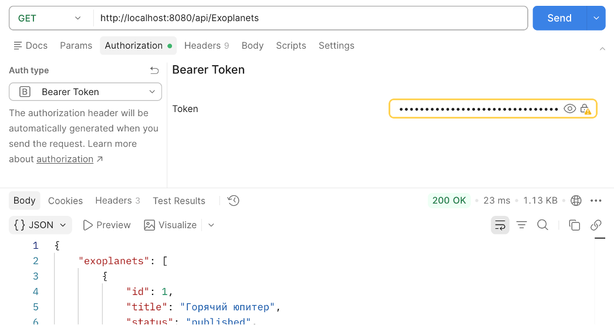

# Exoplanets_backend

**Exoplanets Backend** — учебный веб-проект, посвящённый экзопланетам. Проект разрабатывается в рамках лабораторных работ по веб-разработке и демонстрирует создание пользовательского интерфейса, проектирование архитектуры и реализацию серверной части приложения с использованием различных подходов.

Приложение предоставляет возможность работать с информацией об экзопланетах: просматривать опубликованные записи, создавать и редактировать материалы, управлять черновиками и взаимодействовать с публикациями.

В данный момент проект в процессе, после завершения учебного курса будет сформирован полноценный проект.

Связанный репозиторий для фронтенда:
[Exoplanets_Frontend](https://github.com/a-feel-u/Exoplanets_Frontend)

## Технологии

- **Go** — язык разработки серверной части.
- **Gin** — HTTP-фреймворк для создания REST API.
- **PostgreSQL** — реляционная база данных.
- **GORM** — ORM для работы с базой данных.
- **Redis** — хранение данных сессий и управление авторизацией.
- **MinIO** — объектное хранилище для медиафайлов.
- **JWT** — механизм аутентификации и авторизации.
- **Swagger** — документация и тестирование API.

## Лабораторные работы

Каждая лабораторная работа находится в отдельной ветке репозитория.

### Лабораторная работа №1

**Проектирование и разработка пользовательского интерфейса.**

В рамках работы создан визуальный образ приложения, определены основные страницы и элементы взаимодействия с пользователем.

**Скриншоты:**

- Визуальный вид проекта:
  <!--  -->

[Перейти к ветке SSR](https://github.com/a-feel-u/Exoplanets_backend/tree/SSR)

### Лабораторная работа №2

**Проектирование архитектуры приложения.**
В данной работе разрабатывается база данных, настраивается взаимодействие с ней с помощью GORM.
Рассматривается структура приложения, взаимодействие его компонентов и организация серверной части.

**Скриншоты:**

- ER диаграмма:
  <!--  -->

[Перейти к ветке MakingDB](https://github.com/a-feel-u/Exoplanets_backend/tree/MakingDB)

### Лабораторная работа №3

**Реализация серверной логики и взаимодействия с данными.**

Разработка API.
В рамках работы реализованы методы серверной части для обработки запросов и работы с информацией об экзопланетах, а также взаимодействие с базой данных и другими компонентами приложения.

**Скриншоты:**

- Диаграмма классов бэкенда:
  <!--  -->

- Примеры работы методов:
  <!--  -->

[Перейти к ветке WebService](https://github.com/a-feel-u/Exoplanets_backend/tree/WebService)

### Лабораторная работа №4

**Аутентификация, авторизация и документирование REST API.**

В работе реализованы регистрация и авторизация пользователей с использованием JWT, завершение сессии, проверка прав доступа и разграничение возможностей обычного пользователя и создателя контента.

Также добавлены:
- Хеширование паролей с помощью bcrypt.
- Хранение отозванных JWT-токенов в Redis.
- Middleware для проверки авторизации.
- Проверка прав владельца публикации.
- Документирование API с помощью Swagger UI.
- Защищённые операции создания, публикации и изменения экзопланет.

**Скриншоты:**

- Диаграмма последовательности:
  <!--  -->

- Swagger UI:
  <!--  -->

- Примеры авторизации и проверки доступа:
  <!--  -->

[Перейти к ветке JWT](https://github.com/a-feel-u/Exoplanets_backend/tree/JWT)

## Структура проекта

```text
Exoplanets_backend/
├── cmd/                 # Точки входа приложения
├── internal/
│   ├── app/             # Логика приложения и обработчики
│   └── pkg/             # Вспомогательные компоненты
├── docs/                # Документация Swagger
├── migrations/          # Миграции базы данных
└── go.mod               # Зависимости Go
```

## Цель проекта

Получение практического опыта разработки веб-приложений: от проектирования интерфейса и архитектуры до реализации REST API, работы с базами данных, аутентификации пользователей и документирования серверных методов. В дальнейшем реализуется полноценный проект.
